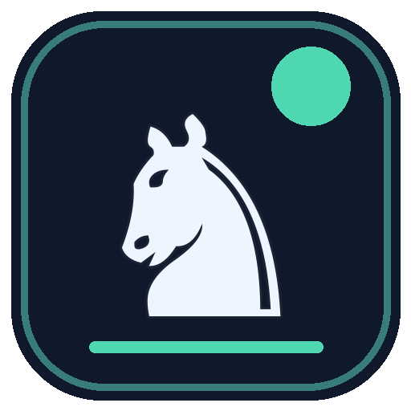

<div align="center">



# ♟️ ChessCoach Live

**Analysez vos parties. Comprenez vos positions. Progressez.**

Application Windows d'analyse d'échecs propulsée par **Stockfish**.

[](https://github.com/noswayedev/ChessCoach-Live/releases)
[](https://github.com/noswayedev/ChessCoach-Live/releases)
[](https://stockfishchess.org/)
[](#-langues-disponibles)

**[⬇️ Télécharger la dernière version](https://github.com/noswayedev/ChessCoach-Live/releases/latest)** · **[🐛 Signaler un bug](https://github.com/noswayedev/ChessCoach-Live/issues)**

</div>

---

## 🇫🇷 Français

### Présentation

**ChessCoach Live** est une application Windows d'entraînement et d'analyse aux échecs. Elle combine le moteur **Stockfish**, un échiquier interactif et une reconnaissance visuelle expérimentale des positions affichées à l'écran. Son interface affiche **un seul coup recommandé** à la fois, avec son point de départ et sa destination.

### ✨ Fonctionnalités

| | Fonctionnalité | Description |
|:--:|---|---|
| 🧠 | **Stockfish intégré** | Analyse des positions sans installation séparée du moteur dans la version compilée. |
| 🎯 | **Un seul coup recommandé** | Affichage clair de la suggestion principale du moteur. |
| 👁️ | **Suivi visuel expérimental** | Détection des déplacements sur un échiquier visible à l'écran. |
| ♟️ | **Échiquier interactif** | Visualisation des pièces, des cases et du déplacement conseillé. |
| ⚙️ | **Paramètres personnalisables** | Choix de la langue, durée de l'analyse et fréquence de détection. |
| 🌐 | **10 langues** | Choix initial en anglais, puis changement possible dans Settings. |
| 📁 | **Import / export** | Positions FEN et export PGN, selon les fonctions de la version. |
| 🖥️ | **Application Windows** | Exécutable avec icône, sans fenêtre console pendant l'utilisation. |

> **Limite connue :** la reconnaissance de l'échiquier est expérimentale. Certains coups peuvent être manqués, en particulier si l'échiquier bouge, si le thème change ou pendant les animations.

### 📥 Installation

1. Ouvrez la page **[Releases](https://github.com/noswayedev/ChessCoach-Live/releases/latest)**.
2. Téléchargez l'archive Windows ou le fichier `ChessCoachLive.exe` proposé dans les fichiers joints (*Assets*).
3. Si nécessaire, extrayez l'archive, puis lancez `ChessCoachLive.exe`.
4. Au premier lancement, choisissez votre langue dans le menu de bienvenue.
5. Pour analyser un échiquier à l'écran, sélectionnez son orientation, calibrez sa zone et démarrez le suivi.

**Python et Stockfish ne sont pas à installer séparément si vous utilisez la version Windows compilée avec le moteur inclus.**

### 🛠️ Compiler depuis les sources

Sur Windows, avec Python installé :

```bat
BUILD_EXE.bat
```

Un workflow GitHub Actions est également fourni dans `.github/workflows/` pour compiler l'application sur une machine Windows. Les fichiers de sortie se trouvent dans les artifacts de l'exécution réussie.

### ⚠️ Utilisation responsable

ChessCoach Live est conçu pour **l'entraînement, l'analyse de parties terminées et les contextes où l'assistance d'un moteur est explicitement autorisée**. Utiliser une aide extérieure pendant une partie en ligne lorsque les règles l'interdisent peut entraîner une suspension ou un bannissement.

**Utilisation à vos risques et périls.** Le développeur décline, dans les limites autorisées par la loi, toute responsabilité liée à des sanctions résultant d'un usage contraire aux règles des plateformes. Cette mention ne dispense pas de respecter leurs conditions d'utilisation.

### 📜 Licence et crédits

- **Application :** développée par [noswayedev](https://github.com/noswayedev).
- **Moteur :** [Stockfish](https://stockfishchess.org/), distribué sous **GNU GPLv3**. Consultez `stockfish/` pour ses notices et les sources fournies. Si vous redistribuez le binaire, veillez à respecter toutes les obligations de la GPLv3.
- **Indépendance :** projet non affilié à Chess.com ni à l'équipe Stockfish.
- **Licence de ChessCoach Live :** le dépôt doit préciser séparément la licence applicable au code de l'application ; la licence de Stockfish ne suffit pas à définir celle de tout le projet.

---

## 🌍 Langues disponibles

Les autres langues sont accessibles ci-dessous. Le **français reste la langue principale de ce README**.

<details>
<summary>🇬🇧 <strong>English</strong></summary>

### About
ChessCoach Live is a Windows chess training and analysis application powered by Stockfish. It offers an interactive board and experimental on-screen board recognition, displaying **one recommended move** at a time.

### Features
- 🧠 Bundled Stockfish engine in the Windows build.
- 🎯 One top engine suggestion, with origin and destination squares.
- 👁️ Experimental visual move detection and board tracking.
- ♟️ Interactive board and move highlighting.
- ⚙️ Language, analysis-time, and detection-interval settings.
- 🌐 Ten available interface languages.

### Download & setup
1. Open the [latest release](https://github.com/noswayedev/ChessCoach-Live/releases/latest).
2. Download the Windows executable or archive from **Assets**.
3. Extract if needed, then run `ChessCoachLive.exe`.
4. Choose your language on first launch.

The packaged version does not require separate Python or Stockfish installation. Detection is experimental and may miss moves.

### Fair play & licensing
Use for training, reviewing completed games, and situations where engine assistance is expressly allowed. Unauthorized assistance during online games may lead to account penalties. **Use at your own risk;** the developer disclaims liability for sanctions caused by rule-breaking use to the extent permitted by law. Stockfish is licensed under GPLv3; see `stockfish/`. ChessCoach Live is not affiliated with Chess.com or Stockfish.

</details>

<details>
<summary>🇪🇸 <strong>Español</strong></summary>

### Descripción
ChessCoach Live es una aplicación de entrenamiento y análisis de ajedrez para Windows basada en Stockfish. Incluye un tablero interactivo y reconocimiento visual experimental, y muestra **una sola jugada recomendada** cada vez.

### Funciones
- 🧠 Motor Stockfish incluido en la versión compilada.
- 🎯 Una recomendación con casillas de origen y destino.
- 👁️ Detección visual experimental de movimientos.
- ♟️ Tablero interactivo con indicaciones visuales.
- ⚙️ Ajustes de idioma, duración del análisis y frecuencia de detección.
- 🌐 Diez idiomas disponibles.

### Descarga
Abre la [última versión](https://github.com/noswayedev/ChessCoach-Live/releases/latest), descarga el ejecutable o archivo para Windows, extráelo si es necesario y ejecuta `ChessCoachLive.exe`. El reconocimiento visual puede omitir movimientos.

### Juego limpio y licencia
Solo para entrenamiento, análisis de partidas terminadas o situaciones que permitan motores. El uso no autorizado puede causar suspensiones. **Úsalo bajo tu responsabilidad.** Stockfish se distribuye bajo GPLv3; consulta `stockfish/`. El proyecto no está afiliado a Chess.com ni al equipo de Stockfish.

</details>

<details>
<summary>🇮🇹 <strong>Italiano</strong></summary>

### Presentazione
ChessCoach Live è un'applicazione Windows per allenamento e analisi degli scacchi basata su Stockfish, con scacchiera interattiva e riconoscimento visivo sperimentale. Mostra **una sola mossa consigliata** alla volta.

### Funzionalità
- 🧠 Motore Stockfish incluso nella versione compilata.
- 🎯 Una mossa consigliata con casella di partenza e arrivo.
- 👁️ Rilevamento visivo sperimentale delle mosse.
- ♟️ Scacchiera interattiva e indicazioni visive.
- ⚙️ Impostazioni per lingua, tempo di analisi e frequenza di rilevamento.
- 🌐 Dieci lingue disponibili.

### Download
Apri l'[ultima release](https://github.com/noswayedev/ChessCoach-Live/releases/latest), scarica l'eseguibile o l'archivio Windows, estrailo se necessario e avvia `ChessCoachLive.exe`. Il riconoscimento visivo può non rilevare alcune mosse.

### Fair play e licenza
Utilizza l'app solo per allenamento, analisi di partite concluse e situazioni in cui l'assistenza del motore è consentita. L'uso non autorizzato può comportare sospensioni. **Utilizzo a proprio rischio.** Stockfish è distribuito sotto GPLv3; vedi `stockfish/`. Nessuna affiliazione con Chess.com o con il team Stockfish.

</details>

<details>
<summary>🇩🇪 <strong>Deutsch</strong></summary>

### Über das Projekt
ChessCoach Live ist eine Windows-Anwendung zum Schachtraining und zur Analyse mit Stockfish, interaktivem Brett und experimenteller Bildschirmerkennung. Sie zeigt jeweils **nur einen empfohlenen Zug** an.

### Funktionen
- 🧠 Stockfish ist in der kompilierten Version enthalten.
- 🎯 Eine Zugempfehlung mit Start- und Zielfeld.
- 👁️ Experimentelle Erkennung gespielter Züge.
- ♟️ Interaktives Brett mit Zugmarkierung.
- ⚙️ Einstellungen für Sprache, Analysezeit und Erkennungsintervall.
- 🌐 Zehn verfügbare Sprachen.

### Download
Öffne die [neueste Version](https://github.com/noswayedev/ChessCoach-Live/releases/latest), lade die Windows-Datei herunter, entpacke sie bei Bedarf und starte `ChessCoachLive.exe`. Die Bilderkennung kann Züge übersehen.

### Fair Play und Lizenz
Nur für Training, Analyse abgeschlossener Partien und Situationen, in denen Engine-Hilfe erlaubt ist. Unerlaubte Nutzung kann zur Kontosperrung führen. **Nutzung auf eigenes Risiko.** Stockfish steht unter GPLv3; siehe `stockfish/`. Keine Verbindung zu Chess.com oder zum Stockfish-Team.

</details>

<details>
<summary>🇵🇹 <strong>Português</strong></summary>

### Sobre
ChessCoach Live é uma aplicação Windows para treino e análise de xadrez com Stockfish, tabuleiro interativo e reconhecimento visual experimental. Apresenta **apenas uma jogada recomendada** de cada vez.

### Funcionalidades
- 🧠 Stockfish incluído na versão compilada.
- 🎯 Uma sugestão de jogada com casa de origem e destino.
- 👁️ Deteção visual experimental de movimentos.
- ♟️ Tabuleiro interativo com realce de jogadas.
- ⚙️ Definições de idioma, tempo de análise e intervalo de deteção.
- 🌐 Dez idiomas disponíveis.

### Transferir
Abre a [versão mais recente](https://github.com/noswayedev/ChessCoach-Live/releases/latest), transfere o executável ou arquivo Windows, extrai se necessário e inicia `ChessCoachLive.exe`. O reconhecimento visual pode falhar algumas jogadas.

### Jogo limpo e licença
Apenas para treino, análise de partidas concluídas e situações em que a assistência do motor seja permitida. O uso não autorizado pode causar suspensão da conta. **Utilização por tua conta e risco.** Stockfish utiliza a GPLv3; consulta `stockfish/`. Sem afiliação à Chess.com ou à equipa Stockfish.

</details>

<details>
<summary>🇷🇺 <strong>Русский</strong></summary>

### О проекте
ChessCoach Live — приложение для Windows для тренировки и анализа шахмат с движком Stockfish, интерактивной доской и экспериментальным распознаванием позиции на экране. Приложение показывает **только один рекомендуемый ход** за раз.

### Возможности
- 🧠 Stockfish включён в собранную версию.
- 🎯 Один рекомендуемый ход с начальным и конечным полями.
- 👁️ Экспериментальное распознавание ходов.
- ♟️ Интерактивная доска с подсветкой.
- ⚙️ Настройки языка, времени анализа и интервала распознавания.
- 🌐 Десять языков интерфейса.

### Загрузка
Откройте [последний релиз](https://github.com/noswayedev/ChessCoach-Live/releases/latest), скачайте файл для Windows, при необходимости распакуйте и запустите `ChessCoachLive.exe`. Распознавание может пропускать ходы.

### Честная игра и лицензия
Используйте программу для тренировок, анализа завершённых партий и только там, где помощь движка разрешена. Нарушение правил может привести к блокировке аккаунта. **Используйте на свой риск.** Stockfish распространяется по GPLv3; см. `stockfish/`. Проект не связан с Chess.com или командой Stockfish.

</details>

<details>
<summary>🇨🇳 <strong>中文</strong></summary>

### 项目简介
ChessCoach Live 是一款适用于 Windows 的国际象棋训练与分析工具，采用 Stockfish 引擎，提供交互式棋盘和实验性的屏幕棋局识别功能。界面每次**只显示一个推荐走法**。

### 主要功能
- 🧠 Windows 编译版本内置 Stockfish。
- 🎯 显示一个推荐走法及起止格。
- 👁️ 实验性的走棋识别与棋盘跟踪。
- ♟️ 交互式棋盘与走法高亮。
- ⚙️ 支持语言、分析时间和检测间隔设置。
- 🌐 提供十种界面语言。

### 下载
打开[最新版本](https://github.com/noswayedev/ChessCoach-Live/releases/latest)，下载 Windows 可执行文件或压缩包，必要时解压，然后运行 `ChessCoachLive.exe`。屏幕识别可能漏掉部分走法。

### 公平使用与许可
仅用于训练、已结束棋局的复盘，以及明确允许引擎辅助的场景。违规使用可能导致账号封禁。**请自行承担使用风险。** Stockfish 使用 GPLv3 许可证，详见 `stockfish/`。本项目与 Chess.com 和 Stockfish 团队无关联。

</details>

<details>
<summary>🇯🇵 <strong>日本語</strong></summary>

### 概要
ChessCoach Live は、Stockfish を搭載した Windows 向けのチェス練習・解析アプリです。操作可能な盤面と実験的な画面認識機能を備え、**推奨手を一度に1手だけ**表示します。

### 主な機能
- 🧠 ビルド済み Windows 版に Stockfish を同梱。
- 🎯 移動元と移動先を含む推奨手を1手表示。
- 👁️ 実験的な指し手認識と盤面追跡。
- ♟️ インタラクティブな盤面とハイライト表示。
- ⚙️ 言語、解析時間、検出間隔の設定。
- 🌐 10言語に対応。

### ダウンロード
[最新リリース](https://github.com/noswayedev/ChessCoach-Live/releases/latest)から Windows 用ファイルを入手し、必要に応じて展開して `ChessCoachLive.exe` を実行してください。画面認識では一部の手を見逃す可能性があります。

### フェアプレーとライセンス
学習、終了した対局の解析、エンジン支援が明示的に許可される場面にのみ使用してください。規則違反はアカウント停止につながる場合があります。**自己責任で利用してください。** Stockfish は GPLv3 で配布されています。詳細は `stockfish/` を参照してください。Chess.com および Stockfish チームとは無関係です。

</details>

<details>
<summary>🇰🇷 <strong>한국어</strong></summary>

### 소개
ChessCoach Live는 Stockfish 엔진을 사용하는 Windows용 체스 훈련 및 분석 프로그램입니다. 대화형 체스판과 실험적인 화면 인식 기능을 제공하며, 한 번에 **추천 수 하나만** 표시합니다.

### 주요 기능
- 🧠 Windows 빌드에 Stockfish 엔진 포함.
- 🎯 출발 칸과 도착 칸을 포함한 추천 수 하나 표시.
- 👁️ 실험적인 수 감지 및 체스판 추적.
- ♟️ 대화형 체스판과 수 강조 표시.
- ⚙️ 언어, 분석 시간 및 감지 간격 설정.
- 🌐 10개 언어 지원.

### 다운로드
[최신 릴리스](https://github.com/noswayedev/ChessCoach-Live/releases/latest)에서 Windows 파일을 다운로드하고 필요한 경우 압축을 푼 뒤 `ChessCoachLive.exe`를 실행하세요. 화면 인식 과정에서 일부 수를 놓칠 수 있습니다.

### 공정한 이용 및 라이선스
훈련, 종료된 대국 분석, 엔진 사용이 명시적으로 허용된 상황에서만 사용하세요. 허용되지 않은 사용은 계정 정지로 이어질 수 있습니다. **사용에 따른 책임은 사용자에게 있습니다.** Stockfish는 GPLv3로 배포되며 자세한 내용은 `stockfish/`를 참고하세요. Chess.com 및 Stockfish 팀과 관련이 없는 프로젝트입니다.

</details>

---

<div align="center">

Développé par **[noswayedev](https://github.com/noswayedev)** · Propulsé par **Stockfish**

**ChessCoach Live 1.7 — Analyze · Learn · Improve**

</div>
